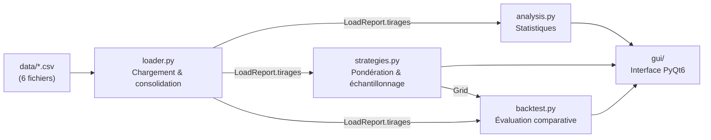
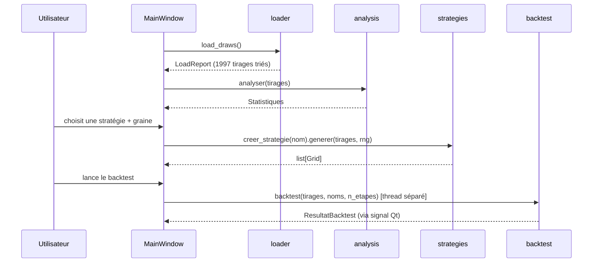

# Architecture

## Vue d'ensemble

Lotto Matrix est organisé en **modules indépendants** : la logique métier
(chargement, analyse, stratégies, backtest) ne dépend pas de l'interface
graphique. On peut donc utiliser le cœur du logiciel depuis un script Python
sans lancer PyQt6.



## Arborescence

```
lotto-matrix/
├── main.py                     # point d'entrée : lance l'interface graphique
├── requirements.txt            # dépendances (PyQt6, matplotlib, numpy, scikit-learn)
├── README.md                   # présentation générale
├── .gitignore
├── data/                       # historique EuroMillions (CSV fournis)
├── doc/                        # cette documentation
└── lotto_matrix/
    ├── __init__.py             # métadonnées du paquet (version)
    ├── loader.py               # chargement / fusion / dédoublonnage des CSV
    ├── analysis.py             # statistiques (fréquences, écarts, paires)
    ├── strategies.py           # les 7 stratégies de prédiction
    ├── backtest.py             # évaluation comparative walk-forward
    └── gui/
        ├── __init__.py         # run() : crée QApplication et la fenêtre
        ├── main_window.py      # fenêtre principale et les 4 onglets
        ├── charts.py           # MplCanvas : canvas matplotlib dans Qt
        └── workers.py          # BacktestWorker : backtest en arrière-plan
```

## Rôle des modules

| Module | Responsabilité | Entrées → Sorties |
|---|---|---|
| `loader.py` | Trouver, parser, valider, dédoublonner et trier les CSV | `data_dir` → `LoadReport` |
| `analysis.py` | Calculer fréquence, écart actuel/moyen, paires | `list[Draw]` → `Statistiques` |
| `strategies.py` | Pondérer les numéros et échantillonner des grilles | `list[Draw]` → `list[Grid]` |
| `backtest.py` | Évaluer les stratégies sur le passé uniquement | `list[Draw]`, noms → `ResultatBacktest` |
| `gui/main_window.py` | Afficher et orchestrer le tout | — |
| `gui/charts.py` | Intégrer matplotlib dans Qt | — |
| `gui/workers.py` | Exécuter le backtest hors du thread d'interface | — |

## Flux de données détaillé



## Conception et extension

### Ajouter une stratégie

1. Créer une classe héritant de `Strategy` dans `strategies.py`.
2. Définir `nom`, `description`, `poids_boules()` et `poids_etoiles()`
   (ou surcharger `generer()` pour un comportement spécifique).
3. Enregistrer la classe dans le dictionnaire `STRATEGIES`.

Elle apparaîtra automatiquement dans la liste déroulante de l'onglet
« Prédiction » et dans les cases de l'onglet « Comparaison ». Voir
[strategies.md](strategies.md#ajouter-une-stratégie).

### Ajouter une source de données

Déposer les nouveaux CSV dans `data/` (les sous-dossiers sont parcourus
récursivement). Aucune configuration n'est nécessaire : `loader.py` repère les
colonnes par leur **nom d'en-tête**. Voir [donnees.md](donnees.md#ajouter-des-données).

### Threading de l'interface

Le backtest peut être long (entraînement du modèle ML). Il s'exécute donc dans
un `QThread` (`BacktestWorker`) qui émet des signaux :

- `progression(int, int, str)` : avancement et tirage courant ;
- `termine(object)` : résultat (`ResultatBacktest`) ;
- `erreur(str)` : message d'erreur à afficher.

L'interface reste ainsi réactive, avec une barre de progression.
