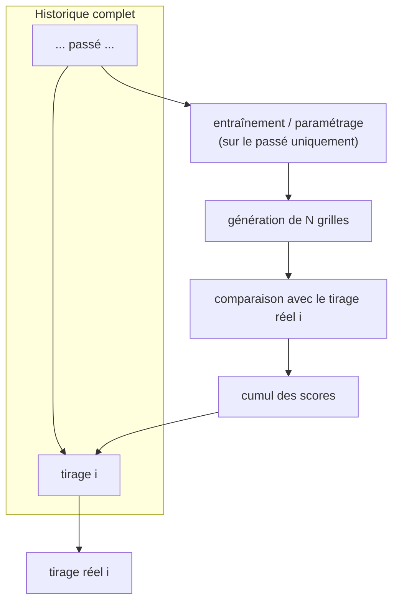

# Backtest

## Objectif

Le backtest répond à une question simple : **une stratégie fait-elle mieux que
le hasard ?** Il évalue chaque stratégie sur des tirages qu'elle n'a *pas* vus,
puis compare le résultat à l'espérance d'une grille jouée au hasard.

## Protocole *walk-forward*



Pour chaque tirage `i` parmi les `n_etapes` derniers :

1. on ne donne à la stratégie que les tirages `0..i-1` ;
2. elle génère `n_grilles` grilles ;
3. on compare à la grille réellement tirée.

On évite ainsi toute **fuite de données** (le futur n'est jamais utilisé pour
prédire le passé). C'est la condition pour que la comparaison soit honnête.

La graine est fixée par étape (`seed + étape`) pour rendre le backtest
**reproductible**.

## Métriques

Pour chaque étape, on retient le **meilleur** résultat parmi les `n_grilles`
grilles générées :

- **boules trouvées** : taille de l'intersection avec les 5 boules réelles (0 à 5) ;
- **étoiles trouvées** : taille de l'intersection avec les 2 étoiles réelles (0 à 2).

Puis on agrège par stratégie :

| Colonne de l'interface | Signification |
|---|---|
| Boules moy. | moyenne des boules trouvées par tirage |
| Étoiles moy. | moyenne des étoiles trouvées par tirage |
| Total moy. | somme des deux (critère de tri) |
| Meilleur | meilleur total obtenu sur un tirage |
| Gains ≥3 boules | nombre de tirages où au moins 3 boules ont été trouvées |

## Espérances théoriques (référence)

Pour une grille jouée au hasard, les nombres trouvés suivent une loi
hypergéométrique :

| Grandeur | Espérance | Formule |
|---|---|---|
| Boules trouvées | **0,5** | `5 × 5 / 50` |
| Étoiles trouvées | **≈ 0,333** | `2 × 2 / 12` |
| Total | **≈ 0,833** | somme |

Ces valeurs sont affichées dans l'interface (`ESPERANCE_BOULES`,
`ESPERANCE_ETOILES`) et tracées comme ligne de référence sur le graphique.

## Exemple de résultat

Backtest de 30 tirages × 1 grille (graine 42, historique complet) :

| Stratégie | Boules moy. | Étoiles moy. | Total moy. | Gains ≥3 boules |
|---|---:|---:|---:|---:|
| Fréquence récente | 0,633 | 0,300 | 0,933 | 0 / 30 |
| Aléatoire uniforme | 0,567 | 0,267 | 0,833 | 1 / 30 |
| Fréquence (chauds) | 0,567 | 0,233 | 0,800 | 1 / 30 |
| Paires fréquentes | 0,433 | 0,300 | 0,733 | 0 / 30 |
| Mixte (chauds + retard) | 0,467 | 0,200 | 0,667 | 0 / 30 |
| Modèle ML | 0,433 | 0,200 | 0,633 | 1 / 30 |
| Retard (froids) | 0,367 | 0,233 | 0,600 | 0 / 30 |

## Interprétation

- Toutes les stratégies **encadrent l'espérance** (≈ 0,83 de total). L'écart
  entre elles est du **bruit d'échantillonnage** : avec seulement 30 tirages, un
  écart de ±0,3 est parfaitement attendu même entre deux méthodes identiques.
- Augmenter `n_etapes` **resserre** les moyennes autour de la même valeur : les
  différences s'estompent. C'est la signature d'un tirage équiprobable.
- Une stratégie qui semblerait « battre le hasard » sur un petit échantillon
  relève de la **chance**, pas d'un pouvoir prédictif.

**Conclusion : le backtest sert à comparer des approches méthodologiquement, pas
à trouver une formule gagnante.** Utilisez-le comme un outil de rigueur et de
pédagogie.

## Lancer un backtest

### Depuis l'interface

Onglet **Comparaison (backtest)** : cochez les stratégies, réglez le nombre de
tirages testés, le nombre de grilles par tirage et la graine, puis cliquez sur
« Lancer le backtest ». Le calcul s'exécute dans un thread séparé (interface
réactive, barre de progression).

### En Python

```python
from lotto_euromillions_matrix.loader import load_draws
from lotto_euromillions_matrix.backtest import backtest, ESPERANCE_BOULES, ESPERANCE_ETOILES

tirages = load_draws().tirages
resultat = backtest(
    tirages,
    noms=["Aléatoire uniforme", "Retard (froids)", "Modèle ML (régression logistique)"],
    n_etapes=100,
    n_grilles=3,
    seed=42,
    progress=lambda i, n, msg: print(f"{i}/{n} {msg}"),
)

for r in resultat.tries():
    print(f"{r.nom:34s} total={r.total_moyen:.3f}  gains={r.grilles_gagnantes}/{r.n_etapes}")

print("référence aléatoire :", ESPERANCE_BOULES + ESPERANCE_ETOILES)
```

> **Performance** : la stratégie ML est la plus lente (elle entraîne 50 modèles
> par étape). Pour un backtest long, privilégiez des `n_etapes` modérés ou
> désélectionnez le modèle ML.
